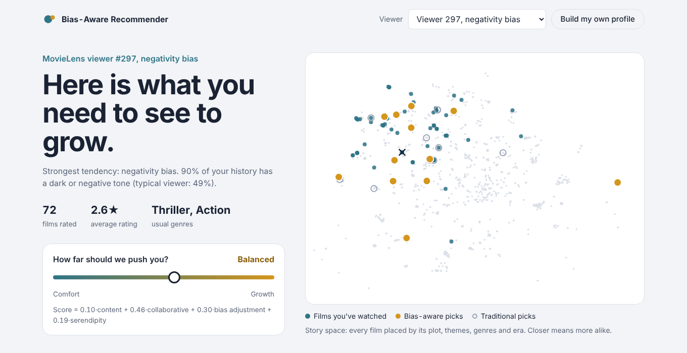
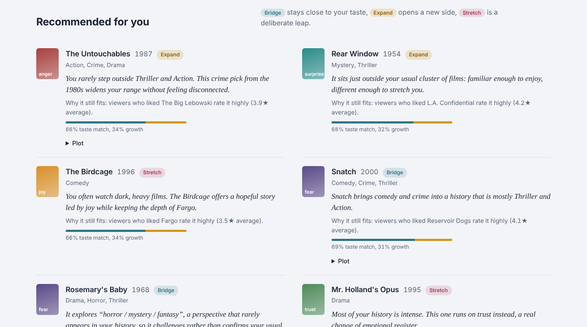
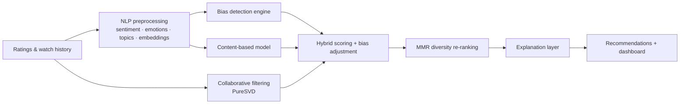
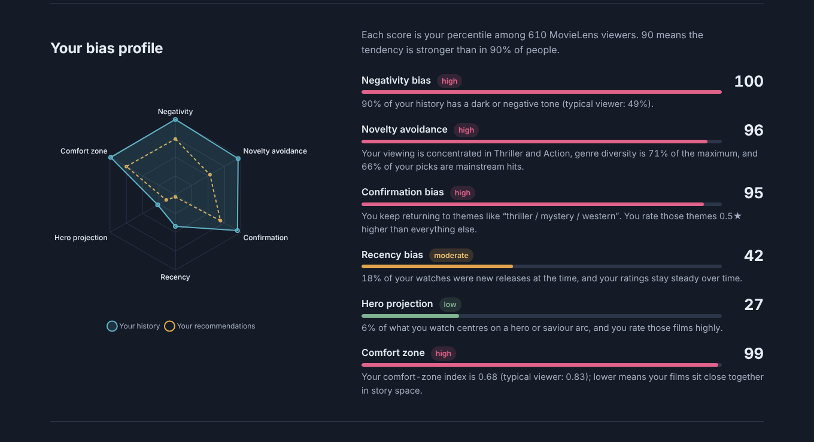

# Bias-Aware Recommender

**A movie recommender that detects the psychological biases in your viewing history and recommends films that counterbalance them, with a plain-language reason for every pick.**

[](https://github.com/ShakyaPranjal/bias-aware-recommender/actions/workflows/ci.yml)


> Traditional recommender: *"Here is more of what you like."*
> This one: *"Here is what you need to see to grow."*



Most recommenders optimise for similarity, which traps people in filter bubbles: the same genres, the same emotional tone, the same handful of blockbusters. This project analyses ratings, watch history, plot synopses and tags to quantify six psychological tendencies, then blends collaborative filtering and content-based filtering with a **bias-adjustment** term that nudges recommendations against those tendencies, without losing personal relevance.

## Features

- **Bias detection engine** that scores six tendencies (negativity, novelty avoidance, confirmation, recency, hero projection, comfort zone) as percentiles against all 610 MovieLens users
- **NLP pipeline**: VADER sentiment on plot overviews and tags, an emotion lexicon (joy, fear, sadness, anger, surprise, trust), NMF topic modelling, and TF-IDF + SVD movie embeddings (Sentence-BERT optional)
- **Hybrid recommender**: PureSVD collaborative filtering + content similarity + bias adjustment + serendipity, re-ranked with Maximal Marginal Relevance for diversity
- **One "Comfort ↔ Growth" slider** that controls how hard the system pushes, live
- **Explanation layer**: every recommendation says which bias it counters, why it still fits your taste, and whether it's a *Bridge*, *Expand* or *Stretch* pick
- **Psychological dashboard**: bias radar, comfort-zone map of "story space" (t-SNE), genre fingerprint, emotional mix
- **Side-by-side comparison** with a traditional recommender on the same history
- **Cold start**: build your own profile by rating a handful of films; no account needed
- Offline evaluation script, test suite, Docker image and CI



## How it works



### The six biases

Every bias has a raw metric and a score: the viewer's percentile among all MovieLens users (0.9 means stronger than 90% of viewers).

| Bias | What it looks like | How it's measured |
|---|---|---|
| Negativity | Prefers dark, tragic or violent films | $N_b = \frac{\#\{\text{movies with negative sentiment}\}}{\#\{\text{all watched movies}\}}$ |
| Novelty avoidance | Same genres, same eras, mainstream hits | genre entropy $H = -\sum_i p_i \log p_i$, era entropy, log-popularity |
| Confirmation | Returns to the same themes and rates them highest | NMF theme concentration + rating gap between familiar and unfamiliar themes |
| Recency | Favours new releases, ratings drift up over time | share of films watched within 2.5 years of release + Spearman ρ(time, rating) |
| Hero projection | Gravitates to hero and saviour arcs | rating-weighted share of hero-archetype films (keywords, tags, genres) |
| Comfort zone | History sits in a tight cluster | $C_z = \frac{1}{N}\sum_i \lVert \mathbf{v}_i - \mathbf{c} \rVert$, with $\mathbf{c}$ the embedding centroid |

### Scoring

$$\text{Score}(m,u) = \alpha\,\text{Content}(m,u) + \beta\,\text{CF}(m,u) + \gamma\,\text{BiasAdj}(m,u) + \delta\,\text{Serendipity}(m,u)$$

- **Content** is the cosine similarity to a taste vector built from your ratings. **CF** is the PureSVD score $r_u V V^\top$. Both are rank-normalised so they compete on equal terms.
- **BiasAdj** is $\sum_b s_b \cdot \text{counter}_b(m) / \sum_b s_b$, where $s_b$ is how strong bias $b$ is for you and $\text{counter}_b(m)$ is how much film $m$ pushes against it (e.g. a brighter tone than your average for negativity).
- **Serendipity** rewards high-quality films in a sweet spot just outside your comfort zone.
- The exploration slider $x \in [0,1]$ sets the weights: $\alpha, \beta$ fall and $\gamma, \delta$ rise as $x$ grows. A relevance floor keeps every candidate within your top collaborative-filtering matches, and MMR re-ranking stops the list from being ten versions of the same film.

## Results

Offline evaluation on MovieLens ml-latest-small with a temporal 80/20 split per user (591 test users, K = 10). A held-out rating of 4.0+ counts as relevant. Reproduce with `python scripts/evaluate.py`.

| Model | Precision@10 | Recall@10 | Coverage | ILS ↓ | Novelty (bits) | Genre entropy gain | Bias Reduction Index |
|---|---|---|---|---|---|---|---|
| Popularity | 0.057 | 0.051 | 0.044 | 0.312 | 1.525 | +0.021 | -0.098 |
| Content-based | 0.018 | 0.016 | 0.557 | 0.872 | 4.730 | -0.025 | -0.109 |
| Collaborative (PureSVD) | 0.080 | 0.092 | 0.311 | 0.322 | 2.572 | +0.008 | -0.049 |
| Hybrid (content + CF) | 0.060 | 0.063 | 0.455 | 0.707 | 3.495 | -0.020 | -0.104 |
| **Bias-aware, exploration 0.3** | 0.041 | 0.041 | 0.353 | 0.318 | 3.282 | +0.009 | **+0.207** |
| **Bias-aware, exploration 0.6** | 0.031 | 0.028 | 0.308 | 0.258 | 3.499 | +0.018 | **+0.359** |
| **Bias-aware, exploration 0.9** | 0.023 | 0.020 | 0.265 | **0.187** | 3.832 | **+0.030** | **+0.480** |

**Reading the table.** Every traditional model has a *negative* Bias Reduction Index: its recommendations are even more biased than the user's own history, which is the filter-bubble effect in numbers. The bias-aware model turns that positive, and the effect grows with the exploration setting, alongside more varied lists (lower intra-list similarity), more novel picks and broader genre coverage.

The cost is lower Precision@10. That is expected: offline precision rewards predicting what a user would have watched anyway, which is exactly the behaviour this system is designed to challenge. The slider makes the trade-off explicit, so a viewer can choose how far to be pushed.

**Bias Reduction Index (BRI).** The recommendation list is analysed as if it were a viewing history, and its bias percentiles are compared with the user's. BRI is the strength-weighted mean drop: above 0 counters the user's biases, below 0 reinforces them.



## Getting started

Requires Python 3.10+.

```bash
git clone https://github.com/ShakyaPranjal/bias-aware-recommender.git
cd bias-aware-recommender
python -m venv .venv && source .venv/bin/activate   # Windows: .venv\Scripts\activate
pip install -r requirements.txt
python scripts/download_data.py      # MovieLens + TMDB plot overviews (~10 MB)
uvicorn biasrec.api:app --reload
```

Open http://localhost:8000. The first start builds the story-space map (about 20 seconds) and caches it; later starts take a few seconds.

### Docker

```bash
docker build -t bias-aware-recommender .
docker run -p 8000:8000 bias-aware-recommender
```

### Tests and evaluation

```bash
pip install -r requirements-dev.txt
pytest -q                          # runs on a synthetic dataset, no download needed
python scripts/evaluate.py         # writes reports/evaluation.md and .json
```

### Configuration

| Variable | Default | Purpose |
|---|---|---|
| `BIASREC_DATA_DIR` | `data/raw` | Where the CSV files live |
| `BIASREC_EMBEDDINGS` | TF-IDF + SVD | Set to `sbert` to use Sentence-BERT embeddings (`pip install sentence-transformers`) |
| `BIASREC_SBERT_MODEL` | `all-MiniLM-L6-v2` | Sentence-BERT model name |

## API

Interactive docs at `/docs` when the server is running.

| Method | Endpoint | Description |
|---|---|---|
| GET | `/api/meta` | Dataset stats, genres, themes, featured demo viewers |
| GET | `/api/users/{id}/analysis?exploration=0.5&k=12` | Bias profile, recommendations, baseline, metrics and map for a MovieLens user |
| POST | `/api/analyze` | Same analysis for a custom profile: `{"ratings": [{"movieId": 1, "rating": 4.5}, ...], "exploration": 0.5}` |
| GET | `/api/movies/search?q=` | Title search |
| GET | `/api/map` | Story-space coordinates for the catalogue |

## Project structure

```
biasrec/
  data.py      loading and cleaning MovieLens + TMDB
  nlp.py       sentiment, emotions, topics, embeddings
  models.py    content-based and collaborative (PureSVD) models
  bias.py      bias detection engine and counter-signals
  explain.py   explanation layer
  engine.py    hybrid scoring, MMR re-ranking, metrics, story-space map
  api.py       FastAPI app
web/           dashboard (HTML, CSS, vanilla JS + Chart.js)
scripts/       download_data.py, evaluate.py
tests/         pytest suite on synthetic data
reports/       evaluation results
```

## Limitations and future work

- Bias scores are behavioural proxies, not clinical measurements; they describe viewing patterns, not people.
- Plot overviews cover about 3,500 of the 9,700 films. The rest rely on genres and tags, so their sentiment is less precise.
- Hero projection uses a keyword heuristic; a character-level model would be more faithful to the idea.
- Custom profiles have no watch dates, so recency bias can only be measured for MovieLens users.
- Next steps: a user study on perceived freshness and satisfaction, learning the weights per user from feedback, and Sentence-BERT or a fine-tuned emotion model by default.

## Data and references

- F. Maxwell Harper and Joseph A. Konstan. 2015. *The MovieLens Datasets: History and Context.* ACM TiiS 5(4). Data from [GroupLens](https://grouplens.org/datasets/movielens/).
- TMDB 5000 Movie Dataset (plot overviews and keywords). This product uses TMDB data but is not endorsed or certified by TMDB.
- Herlocker et al. (2004). *Evaluating Collaborative Filtering Recommender Systems.*
- Burke, R. (2002). *Hybrid Recommender Systems: Survey and Experiments.*
- Adomavicius, G. & Tuzhilin, A. (2005). *Toward the Next Generation of Recommender Systems.*
- Cremonesi, P., Koren, Y. & Turrin, R. (2010). *Performance of Recommender Algorithms on Top-N Recommendation Tasks* (PureSVD).
- Hutto, C. & Gilbert, E. (2014). *VADER: A Parsimonious Rule-based Model for Sentiment Analysis of Social Media Text.*
- Carbonell, J. & Goldstein, J. (1998). *The Use of MMR, Diversity-Based Reranking for Reordering Documents.*

## Author

**Pranjal Man Shakya**, Department of Mathematics, Kathmandu University
GitHub: [@ShakyaPranjal](https://github.com/ShakyaPranjal)

Released under the [MIT License](LICENSE).
